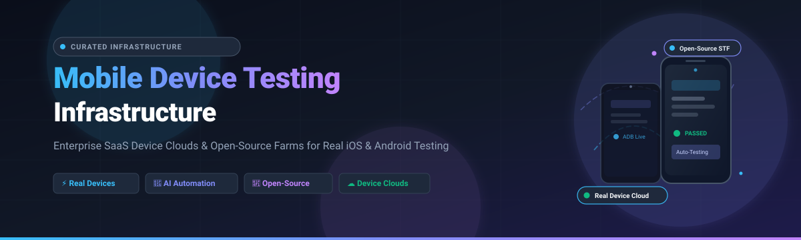

# Awesome Mobile Device Testing Infrastructure

  

  
  
  
  
  
  

> 📱 A comprehensive, curated catalog of enterprise SaaS real device testing clouds and open-source device farm infrastructure for automated testing, continuous integration (CI/CD), remote debugging, manual QA, and AI agent execution across physical iOS and Android smartphones and tablets.
> 
> 🌟 **Star this repository if you find it helpful!** 🌟

---

## 🧭 Table of Contents

- [📈 Sector Overview & Market Dynamics](#-sector-overview--market-dynamics)
- [🟦 SaaS & Hosted Device Testing Clouds](#-saas--hosted-device-testing-clouds)
  - [Enterprise SaaS Comparison Table](#-enterprise-saas-comparison-table)
  - [Detailed SaaS Platform Breakdown](#-detailed-saas-platform-breakdown)
- [🟩 Open-Source Device Testing Infrastructure](#-open-source-device-testing-infrastructure)
  - [Ranked Open-Source Solutions](#-ranked-open-source-solutions)
  - [Open-Source Solutions Detail](#-open-source-solutions-detail)
- [📊 Feature Matrix & Architectural Comparison](#-feature-matrix--architectural-comparison)
- [🤝 Contributing Guidelines](#-contributing-guidelines)
- [💖 Support & Sponsorship](#-support--sponsorship)
- [📈 Star History](#-star-history)
- [📄 License & Disclaimers](#-license--disclaimers)

---

## 📈 Sector Overview & Market Dynamics

The global mobile application testing and device infrastructure market is estimated at **$13.5B to $15.8B**, expanding at a robust **15.4% CAGR** driven by mobile-first business models, handset fragmentation (thousands of distinct Android OEM builds and iOS iterations), and automated CI/CD pipeline adoption. The sector is **moderately fragmented yet top-heavy**, with hyperscalers (Amazon AWS, Google Cloud) and established multi-billion-dollar test giants (BrowserStack, Sauce Labs/Perforce/SmartBear) commanding the enterprise device cloud tier, while specialized AI-native and self-hosted open-source testing solutions rapidly innovate in edge niches.

---

## 🟦 SaaS & Hosted Device Testing Clouds

Commercial, cloud-hosted mobile device testing infrastructure platforms providing immediate access to real Android and iOS hardware pools across global data centers.

### 📊 Enterprise SaaS Comparison Table

Sorted descending by company size (valuation / estimated market capitalization / parent group enterprise value):

| Platform | Company Size (Valuation / Revenue) | Starting Pricing (Paid Tier) | Free Tier / Trial Limit | Key Focus & Specialties |
|:---|:---|:---|:---|:---|
| **[AWS Device Farm](https://aws.amazon.com/devicefarm/)** | **~$2.0T+ Market Cap** (Amazon / AWS Cloud Unit) | **$0.17/device-minute** (pay-as-you-go) or **$250/month** per unmetered device slot | **1,000 free device minutes** one-time trial credit (expires upon depletion) | Pay-as-you-go real device testing, native AWS IAM & VPC integration, fully managed Appium endpoint |
| **[Firebase Test Lab](https://firebase.google.com/docs/test-lab)** | **~$2.0T+ Market Cap** (Alphabet / Google Cloud) | **$1.00/hour** for virtual devices, **$5.00/hour** for physical real devices (Blaze Plan) | **Spark Free Plan:** 5 physical device test runs/day + 10 virtual device test runs/day (free forever) | Seamless Android Studio and Firebase integration, automated Robo testing without pre-written scripts |
| **[Samsung Remote Test Lab](https://developer.samsung.com/remote-test-lab)** | **~$350B+ Market Cap** (Samsung Electronics) | **100% Free Service** (Requires Samsung Developer Account registration) | **20 credits/day free forever** (1 credit = 15 min; up to 5 hours testing daily; 10 hrs max reservation) | Free remote access to flagship Galaxy devices, Galaxy Z Fold/Flip foldables, and Galaxy Watch series |
| **[BrowserStack Mobile Cloud](https://www.browserstack.com/)** | **~$4.0B Valuation** ($200M+ ARR) | **$29/month** (App Live manual, billed annually) / **$199/month** (App Automate 1 parallel thread) | **Free forever plan:** 1 user, 100 mins automated mobile testing, 30 mins manual App Live testing | 30,000+ real iOS & Android hardware devices, day-0 OS release updates, global network simulation |
| **[Sauce Labs Real Device Cloud](https://saucelabs.com/)** | **~$1.2B - $1.4B Valuation** ($150M+ ARR) | **$39/month** (Live testing, billed annually) / **$160/month** (Virtual/Real automation tiers) | **28-day free trial:** includes 60 minutes of real device testing + 3,000 automated minutes | Real Device Access API (raw ADB/xcrun streaming), 24-hour soak test sessions, MCP-ready for AI agents |
| **[Perfecto](https://www.perfecto.io/)** | **~$1.0B+ Parent Valuation** (Acquired by Perforce Software) | **$83/month** (Live/Manual testing, billed annually) / **$360/month** (Automated device cloud) | **14-day free trial:** includes 240 device minutes of automated and manual testing | Enterprise-grade security, dedicated hosted device clouds, biometrics, audio, and sensor testing |
| **[BitBar](https://smartbear.com/product/bitbar/)** | **~$600M+ Parent Valuation** (SmartBear Software) | **$47/month** (BitBar Live Testing, billed annually) / Custom automated device pricing | **14-day free trial:** full access to real Android and iOS testing grids without credit card | Unlimited testing minutes per concurrency slot, AlertSite integration for 24/7 production monitoring |
| **[Kobiton](https://kobiton.com/)** | **~$150M - $200M Valuation** (Series B Funded) | **$83/month** (Startup Plan, billed annually) / **$399/month** (Accelerate Automation tier) | **15-day free trial:** 120 minutes of real device testing with full platform capability access | Nova AI scriptless automation engine, real-time biometrics, on-premises private device lab hybrid setup |
| **[HeadSpin](https://www.headspin.io/)** | **~$100M - $150M Valuation** (Tiger Global / GV backed) | **$60/month** per user (Starter manual plan) / Contact sales for enterprise global telemetry | **14-day free trial:** includes access to global real device test beds upon business domain approval | Carrier-grade SIM-enabled devices across 70+ locations, 130+ packet-level performance vitals |
| **[TestGrid](https://testgrid.io/)** | **~$25M - $40M Valuation** (Bootstrapped / Seed Funded) | **$25/month** per user (Freemium/Starter) / **$199/month** for full private cloud device automation | **Free forever plan:** 200 minutes of device testing, 200 automation minutes, 2 devices max | AI CoTester natural language script generator, AgentRx self-healing test automation, IoT & POS support |

---

### 🔍 Detailed SaaS Platform Breakdown

#### 1. ☁️ AWS Device Farm
- **Starting Price:** `$0.17/device-minute` (pay-as-you-go) or `$250/month` per unmetered device slot.
- **Free Limit:** **1,000 free device minutes** trial credit upon AWS account sign-up.
- **Overview:** AWS Device Farm allows developers and QA teams to run automated tests or manually interact with real physical iOS and Android devices without managing physical hardware racks. Built for enterprise devops with native IAM roles, CloudWatch log ingestion, and private subnet connectivity.
- **Framework Support:** Appium (Java, Python, Node.js, Ruby), Espresso, XCTest, and UI Automator.

#### 2. ⚡ Firebase Test Lab
- **Starting Price:** `$1.00/hour` for virtual devices, `$5.00/hour` for real physical devices (Blaze Plan).
- **Free Limit:** **Spark Plan:** 5 physical device test runs/day + 10 virtual device test runs/day (free forever).
- **Overview:** Fully managed testing infrastructure hosted in Google data centers. Features automated Robo testing that crawls application UI hierarchies automatically to uncover crashes, memory leaks, and UX regressions without writing test scripts.
- **Framework Support:** Espresso, Robo test, Game Loop, Android Test Orchestrator, XCTest.

#### 3. 📱 Samsung Remote Test Lab (RTL)
- **Starting Price:** **100% Free** (Samsung Developer Account).
- **Free Limit:** **20 credits daily free forever** (1 credit = 15 minutes; up to 5 hours daily access).
- **Overview:** Remote hardware testing lab specifically built by Samsung for verification across the entire Galaxy family, including foldable Galaxy Z Flip/Fold displays, S-Pen input latency, and wearable smartwatches.
- **Capabilities:** Interactive web client, touch/multitouch events, display orientation, ADB screen capture.

#### 4. 🌐 BrowserStack Mobile Device Cloud
- **Starting Price:** `$29/month` (App Live manual, billed annually) or `$199/month` (App Automate).
- **Free Limit:** **Free forever tier:** 1 user, 100 mins automated mobile testing, 30 mins manual App Live testing.
- **Overview:** Industry standard real-device testing cloud featuring 30,000+ real Android and iOS phones hosted in 19 geo-distributed data centers. Supports day-0 testing for new hardware and iOS/Android beta builds.
- **Framework Support:** Appium, Espresso, XCUITest, Flutter, React Native Detox, EarlGrey.

#### 5. 🔬 Sauce Labs Real Device Cloud
- **Starting Price:** `$39/month` (Live testing) or `$160/month` (Automation concurrency).
- **Free Limit:** **28-day free trial:** includes 60 minutes of real device testing and 3,000 automated minutes.
- **Overview:** Developer-centric testing platform featuring a dedicated Real Device Access API. Exposes device primitives via standard REST and streaming protocols, enabling AI agents and custom orchestrators to trigger raw ADB/xcrun commands.
- **Specialty:** Model Context Protocol (MCP) compatible, 24-hour battery/soak testing sessions.

#### 6. 🏢 Perfecto by Perforce
- **Starting Price:** `$83/month` (Live testing, billed annually) or `$360/month` (Automated cloud).
- **Free Limit:** **14-day free trial:** includes 240 minutes across real mobile devices.
- **Overview:** Enterprise testing platform focused on heavily regulated industries (banking, healthcare, defense). Offers dedicated, isolated hardware hosting, carrier network emulation, and biometric bypass mechanisms.
- **Specialty:** Strict compliance, audio validation, fingerprint and Face ID simulation.

#### 7. 🛠️ BitBar by SmartBear
- **Starting Price:** `$47/month` (Live testing) with unmetered testing time per concurrency.
- **Free Limit:** **14-day free trial:** full access to real Android and iOS device clouds.
- **Overview:** High-throughput automated mobile app testing grid that supports any native test automation framework. Integrates directly into SmartBear AlertSite to convert functional test scripts into production monitors.
- **Framework Support:** Native XCTest, Espresso, Appium, Selenium, Calabash.

#### 8. 🧠 Kobiton
- **Starting Price:** `$83/month` (Startup Plan) or `$399/month` (Accelerate Plan).
- **Free Limit:** **15-day free trial:** 120 minutes of real mobile device testing time.
- **Overview:** Hybrid testing cloud that allows teams to combine public cloud devices, private hosted devices, and on-premises local workstations into a single unified farm managed by its Nova AI engine.
- **Specialty:** Scriptless test authoring, automated code export to Appium, visual regression analysis.

#### 9. 🚀 HeadSpin
- **Starting Price:** `$60/month` per seat (Starter) or enterprise customized deployments.
- **Free Limit:** **14-day free trial:** accessible upon corporate email validation.
- **Overview:** Global real-device experience platform pairing physical devices with active SIM cards attached to carrier networks in 70+ countries. Captures granular audio/video quality metrics, packet captures (PCAP), and network latency.
- **Specialty:** Global carrier roaming, edge AI performance analysis, streaming media benchmarking.

#### 10. 🎯 TestGrid
- **Starting Price:** `$25/month` per user or `$199/month` for dedicated device automation.
- **Free Limit:** **Free forever tier:** 200 minutes real device testing, 200 automation minutes, 2 devices.
- **Overview:** Modern end-to-end testing platform offering scriptless AI CoTester generation, self-healing test automation (AgentRx), and physical device vital tracking (CPU, memory, temperature, battery drain).
- **Specialty:** Scriptless test authoring, IoT device validation, POS device integrations.

---

## 🟩 Open-Source Device Testing Infrastructure

Self-hosted, transparent, and community-maintained software projects designed to orchestrate physical smartphones, emulators, and local device racks.

### 🌟 Ranked Open-Source Solutions

Sorted descending by GitHub stargazer count:

| Rank | Project | GitHub_Stars | Primary Stack | License | Core Architecture & Use Case |
|:---:|:---|:---:|:---|:---|:---|
| 1 | **[Genymobile/scrcpy](https://github.com/Genymobile/scrcpy)** |  | C / Java / Android | Apache-2.0 | Ultra low-latency display and touch control for Android hardware over USB/TCP; client-server architecture |
| 2 | **[SeleniumHQ/selenium](https://github.com/SeleniumHQ/selenium)** |  | Java / Python / C# / JS | Apache-2.0 | The foundational W3C WebDriver browser automation framework & Selenium Grid device hub |
| 3 | **[appium/appium](https://github.com/appium/appium)** |  | TypeScript / Node.js | Apache-2.0 | Industry-standard cross-platform automation server for native, hybrid, and web apps on iOS and Android |
| 4 | **[mobile-dev-inc/Maestro](https://github.com/mobile-dev-inc/Maestro)** |  | Kotlin / Java | Apache-2.0 | Painless, declarative YAML-driven E2E mobile UI automation framework built with resilience to flakiness |
| 5 | **[openstf/stf](https://github.com/openstf/stf)** *(Archived)* |  | JavaScript / Node.js / RethinkDB | Other (OSS) | Original Smartphone Test Farm for controlling Android hardware fleets remotely from web browsers |
| 6 | **[wix/Detox](https://github.com/wix/Detox)** |  | JavaScript / Kotlin / Objective-C | MIT | Gray-box end-to-end testing and automation library for React Native and native mobile applications |
| 7 | **[mobile-next/mobile-mcp](https://github.com/mobile-next/mobile-mcp)** |  | TypeScript / MCP Protocol | Apache-2.0 | Model Context Protocol server enabling Claude Code, Cursor, and AI agents to manipulate simulators and real devices |
| 8 | **[DeviceFarmer/stf](https://github.com/DeviceFarmer/stf)** |  | Node.js / TypeScript / ADB | Apache-2.0 | Actively maintained community continuation fork of STF with modern Docker, Node, and ADB support |
| 9 | **[NetrisTV/ws-scrcpy](https://github.com/NetrisTV/ws-scrcpy)** |  | TypeScript / WebSockets | MIT | Web browser client prototype and remote streaming gateway for scrcpy over WebSockets and WebCodecs |
| 10 | **[SonicCloudOrg/sonic-server](https://github.com/SonicCloudOrg/sonic-server)** |  | Java / Spring Boot / Vue | Apache-2.0 | Distributed cloud mobile device testing platform supporting Android, iOS, Windows, and macOS endpoints |
| 11 | **[AppiumTestDistribution/AppiumTestDistribution](https://github.com/AppiumTestDistribution/AppiumTestDistribution)** |  | Java | Apache-2.0 | Standalone multi-device runner for parallel execution of Appium test suites across connected target phones |
| 12 | **[AppiumTestDistribution/appium-device-farm](https://github.com/AppiumTestDistribution/appium-device-farm)** |  | TypeScript / Appium 2.0 Plugin | Apache-2.0 | Official Appium 2.0 plugin designed to dynamically manage, allocate, and distribute sessions on available devices |
| 13 | **[shamanec/GADS](https://github.com/shamanec/GADS)** |  | Go / Appium / WebDriverAgent | AGPL-3.0 / Dual | Self-hosted device farm for remote control and Appium test orchestration on physical Android, iOS, and Smart TVs |

---

### 📦 Open-Source Solutions Detail

#### 1. 📱 [Genymobile/scrcpy](https://github.com/Genymobile/scrcpy)
- **Repository:** `Genymobile/scrcpy`
- **Tech Stack:** C, Java, Android MediaCodec
- **License:** Apache-2.0
- **Highlights:** Provides lightning-fast screen mirroring (30~120 FPS) and low-latency input injection (35~70ms) with zero device-side root required. Serves as the high-performance display engine underpinning many private device labs and DIY test setups.

#### 2. 🌐 [SeleniumHQ/selenium](https://github.com/SeleniumHQ/selenium)
- **Repository:** `SeleniumHQ/selenium`
- **Tech Stack:** Java, Python, C#, JavaScript, W3C WebDriver
- **License:** Apache-2.0
- **Highlights:** The bedrock of web and mobile browser automation. Selenium Grid allows central routing and distribution of browser sessions across distributed nodes, virtual machines, and attached mobile devices.

#### 3. 🤖 [appium/appium](https://github.com/appium/appium)
- **Repository:** `appium/appium`
- **Tech Stack:** TypeScript, Node.js
- **License:** Apache-2.0
- **Highlights:** The standard cross-platform test automation framework. Appium 2.0 features a decoupled plugin and driver architecture (XCUITest, UiAutomator2, Espresso, Chromium, Safari), allowing custom device discovery and streaming handlers.

#### 4. ⚡ [mobile-dev-inc/Maestro](https://github.com/mobile-dev-inc/Maestro)
- **Repository:** `mobile-dev-inc/Maestro`
- **Tech Stack:** Kotlin, Java, YAML
- **License:** Apache-2.0
- **Highlights:** Built by Mobile.dev, Maestro provides ultra-clean, declarative test flows that run locally or in CI against Android emulators and iOS simulators. It automatically handles UI delays and animations to eliminate flaky test runs.

#### 5. 🏛️ [openstf/stf](https://github.com/openstf/stf) *(Archived)*
- **Repository:** `openstf/stf`
- **Tech Stack:** JavaScript, Node.js, RethinkDB, ZeroMQ
- **License:** Other Open Source
- **Highlights:** The pioneer in web-based Android device farms. Allowed remote control, multitouch, APK installation, and ADB port forwarding over a browser UI. *Note: Original repo unmaintained since May 2023; use DeviceFarmer fork for production deployments.*

#### 6. ⚛️ [wix/Detox](https://github.com/wix/Detox)
- **Repository:** `wix/Detox`
- **Tech Stack:** JavaScript, Kotlin, Objective-C
- **License:** MIT
- **Highlights:** Gray-box testing framework tailored for mobile apps with deep synchronization with the app runtime. Detox monitors asynchronous app state, preventing timing bugs without arbitrary thread sleep statements.

#### 7. 🧠 [mobile-next/mobile-mcp](https://github.com/mobile-next/mobile-mcp)
- **Repository:** `mobile-next/mobile-mcp`
- **Tech Stack:** TypeScript, Model Context Protocol
- **License:** Apache-2.0
- **Highlights:** Connects AI coding assistants (Claude Code, Cursor, Copilot) directly to mobile simulators, emulators, and physical devices. Uses native accessibility trees instead of heavy pixel screenshots to save token costs and enhance deterministic AI actions.

#### 8. 🚜 [DeviceFarmer/stf](https://github.com/DeviceFarmer/stf)
- **Repository:** `DeviceFarmer/stf`
- **Tech Stack:** Node.js, TypeScript, ADB, Docker
- **License:** Apache-2.0
- **Highlights:** Actively maintained community hard fork of OpenSTF. Restores modern Android version support, modernizes the Node.js toolchain, updates ADB streaming protocols, and packages seamless Docker Compose recipes.

#### 9. 📡 [NetrisTV/ws-scrcpy](https://github.com/NetrisTV/ws-scrcpy)
- **Repository:** `NetrisTV/ws-scrcpy`
- **Tech Stack:** TypeScript, WebSockets, WebCodecs, H.264
- **License:** MIT
- **Highlights:** Exposes scrcpy streams via WebSockets directly into modern HTML5 canvas elements. Allows remote multi-device management, keyboard redirection, and low-bandwidth remote control from any standard web browser.

#### 10. ☁️ [SonicCloudOrg/sonic-server](https://github.com/SonicCloudOrg/sonic-server)
- **Repository:** `SonicCloudOrg/sonic-server`
- **Tech Stack:** Java, Spring Boot, Vue.js, Netty
- **License:** Apache-2.0
- **Highlights:** Next-generation distributed mobile device farm architecture. Deploys lightweight agent nodes across Windows, macOS, and Linux host servers, offering unified web-based remote control, performance profiling, and test distribution.

#### 11. 🔄 [AppiumTestDistribution/AppiumTestDistribution](https://github.com/AppiumTestDistribution/AppiumTestDistribution)
- **Repository:** `AppiumTestDistribution/AppiumTestDistribution`
- **Tech Stack:** Java, Appium
- **License:** Apache-2.0
- **Highlights:** Standalone test orchestrator that dynamically allocates connected Android and iOS devices, spins up parallel Appium runner instances, and compiles unified HTML test execution reports.

#### 12. 🧩 [AppiumTestDistribution/appium-device-farm](https://github.com/AppiumTestDistribution/appium-device-farm)
- **Repository:** `AppiumTestDistribution/appium-device-farm`
- **Tech Stack:** TypeScript, Appium 2.0
- **License:** Apache-2.0
- **Highlights:** Official Appium 2.0 plugin designed for device discovery, reservation, and driver allocation. Eliminates complex custom routing scripts by transforming a standard Appium server into an automated multi-device scheduler.

#### 13. 🛡️ [shamanec/GADS](https://github.com/shamanec/GADS)
- **Repository:** `shamanec/GADS`
- **Tech Stack:** Go, Appium, WebDriverAgent
- **License:** AGPL-3.0 (Core) / Proprietary UI
- **Highlights:** Lightweight self-hosted device farm written in Go. Delivers low-latency WebRTC and MJPEG remote video feeds for iOS and Android hardware, alongside Smart TV automation nodes for Samsung Tizen and LG webOS.

---

## 📊 Feature Matrix & Architectural Comparison

| Infrastructure Solution | Deployment Model | Real Devices | Remote Manual Control | Automated Parallel Execution | AI / Agent Ready | Best Suited For |
|:---|:---:|:---:|:---:|:---:|:---:|:---|
| **AWS Device Farm** | Managed Cloud | ✅ Physical | ✅ Browser Remote | ✅ Appium / Native | ⚠️ Custom API | AWS ecosystems & enterprise pay-per-minute needs |
| **Firebase Test Lab** | Managed Cloud | ✅ Physical + Virtual | ❌ Headless Runs | ✅ Robo / Espresso | ⚠️ Google AI | Android CI/CD pipelines & rapid crash detection |
| **Samsung RTL** | Free Hosted | ✅ Samsung Only | ✅ RTL Web Client | ❌ Manual Focused | ❌ | Free testing on Samsung hardware & foldables |
| **BrowserStack** | Managed Cloud | ✅ 30,000+ Hardware | ✅ App Live | ✅ High Concurrency | ⚠️ Plugins | Broadest global device matrix & cross-browser QA |
| **Sauce Labs** | Managed / Hybrid | ✅ Real Hardware | ✅ RDA Console | ✅ Enterprise Concurrency | ✅ MCP Ready | AI-driven testing, deep ADB control & soak tests |
| **Perfecto** | Cloud / On-Prem | ✅ Private Racks | ✅ Interactive | ✅ Continuous Testing | ⚠️ Test Analytics | Regulated industries with strict compliance |
| **BitBar** | Cloud / On-Prem | ✅ Real Hardware | ✅ Live Testing | ✅ Unmetered Slots | ⚠️ Monitoring | Fixed-cost parallel automation & synthetic monitoring |
| **Kobiton** | Cloud / On-Prem | ✅ Hybrid Hub | ✅ Web Console | ✅ Scriptless AI | ✅ Nova AI Engine | AI script generation & enterprise private labs |
| **HeadSpin** | Managed Cloud | ✅ SIM-Enabled | ✅ Global Devices | ✅ Performance Tests | ✅ Vitals AI | Global carrier network simulation & media apps |
| **TestGrid** | Cloud / On-Prem | ✅ Real Hardware | ✅ Interactive | ✅ AgentRx Self-Healing | ✅ CoTester AI | Scriptless automation & budget-friendly teams |
| **scrcpy** | Local / Self-Hosted | ✅ USB / TCP | ✅ Low Latency GUI | ❌ Requires Runner | ⚠️ Shell Scriptable | Ultra-fast local device display & interaction |
| **Selenium Grid** | Self-Hosted | ✅ Emulators / Web | ❌ Headless Driver | ✅ Distributed Grid | ⚠️ Standard API | Large-scale multi-browser test distribution |
| **Appium 2.0** | Local / Self-Hosted | ✅ Mobile Hardware | ❌ Driver Engine | ✅ Parallel Drivers | ⚠️ Agent Tools | Foundational mobile UI automation foundation |
| **Maestro** | Local / Cloud | ✅ Simulators / Devices | ❌ CLI Engine | ✅ Parallel Runner | ⚠️ AI YAML Gen | Declarative, developer-friendly mobile E2E tests |
| **Device Farmer STF** | Self-Hosted | ✅ Android Hardware | ✅ Web UI & ADB | ⚠️ With Test Runners | ⚠️ Custom Scripts | On-premises Android device sharing for teams |
| **Sonic** | Self-Hosted | ✅ Android & iOS | ✅ Web Console | ✅ Distributed Nodes | ⚠️ Webhook Gen | Cross-platform multi-OS enterprise internal farms |
| **Mobile MCP** | Local / Agent | ✅ Real & Simulators | ✅ Agent Driven | ✅ Prompt Controlled | ✅ Native MCP | Autonomous AI coding agents (Claude, Cursor) |
| **GADS** | Self-Hosted | ✅ Android, iOS, TV | ✅ WebRTC Web UI | ✅ Appium Grid Node | ⚠️ API Driven | On-premises Apple, Android & Smart TV labs |

---

## 🤝 Contributing Guidelines

Contributions are warmly appreciated! If you maintain or use a noteworthy mobile device testing infrastructure tool that belongs on this list, please submit a pull request:

1. **Verify Project Health:** Ensure the repository has received active commits or releases within the past 12 months.
2. **Follow Format:** Provide the project name, hyperlinked repository/website, primary technology stack, license, and a concise summary.
3. **Open a PR:** Submit your pull request with a descriptive title (e.g., `Add ProjectName to Open-Source Infrastructure`).

---

## 💖 Support & Sponsorship

Thank you so much for exploring and supporting **Awesome Mobile Device Testing Infrastructure**! 🙌

If this curated repository has saved you time, helped you evaluate device testing infrastructure, or streamlined your mobile QA architecture, please consider supporting the project:

- 🌟 **Star** this repository on GitHub to help others discover it.
- 🍴 **Fork** and contribute back new open-source or commercial testing platforms.
- 📢 **Share** this resource with your colleagues, engineering teams, and QA communities.
- ☕ **Buy me a coffee / Sponsor**: If you'd like to back ongoing maintenance and open-source research, contributions via the GitHub Sponsors program are deeply appreciated!  
  👉 **[Support on GitHub Sponsors](https://github.com/sponsors/ishandutta2007)**

---

## 📈 Star History

---

## 📄 License & Disclaimers

This curated compilation is released under the **[Creative Commons Zero v1.0 Universal](LICENSE)** (Public Domain Dedication).  
Individual tools, frameworks, and commercial platforms listed herein remain the copyrighted property and registered trademarks of their respective owners.
